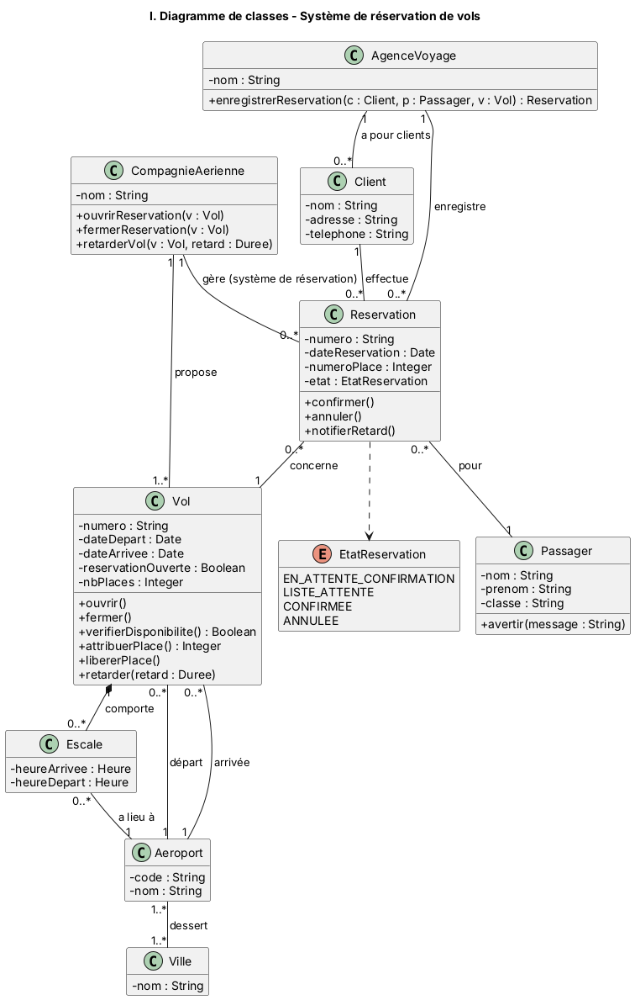
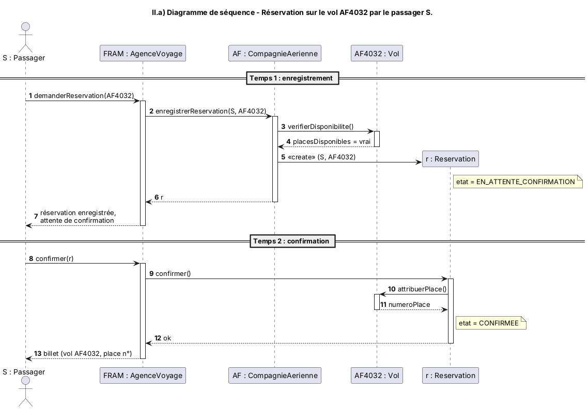
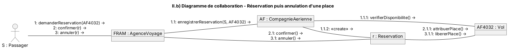
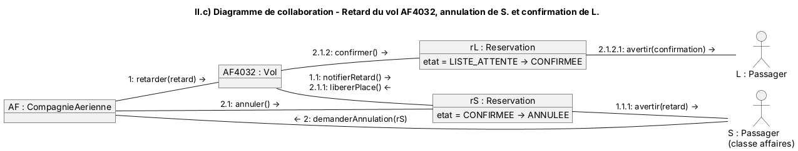
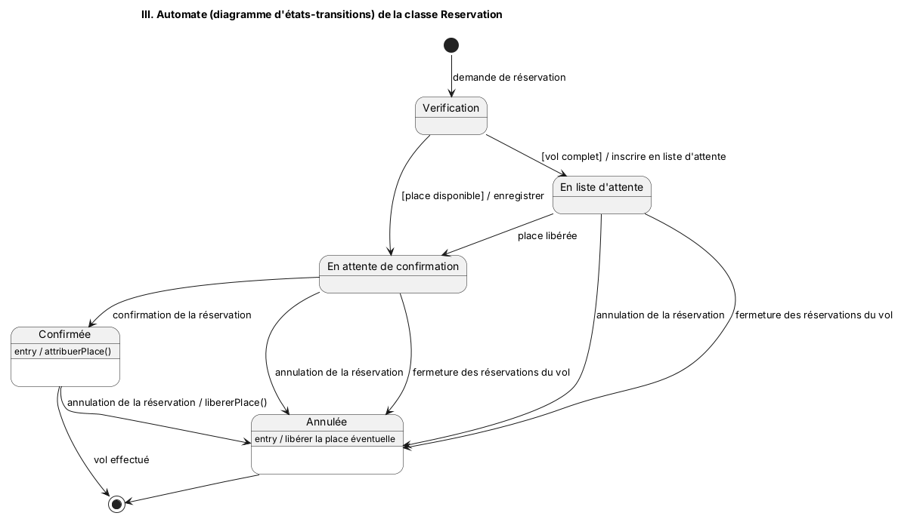
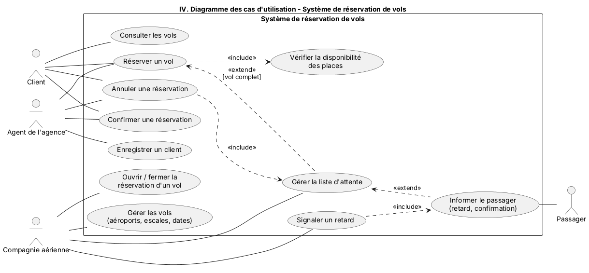

# TD1 – Bases UML : système de réservation de vols

Sources PlantUML dans `src/`, images générées dans `images/`.
Régénérer : `java -jar plantuml.jar -tpng -charset UTF-8 -o ../images src/*.puml`

## I. Diagramme de classes

- Une **CompagnieAerienne** propose plusieurs **Vol**s, et ouvre/ferme leur réservation (`ouvrir()`/`fermer()`).
- La compagnie gère les **Reservation**s (son système de réservation) ; l'**AgenceVoyage** les enregistre pour ses **Client**s.
- Un client effectue 0..* réservations, pour lui ou pour d'autres **Passager**s ; une réservation concerne **un seul vol et un seul passager**.
- L'état d'une réservation (`EtatReservation`) permet l'annulation, la confirmation et la liste d'attente.
- Un vol a un aéroport de départ et un d'arrivée, des dates de départ/arrivée et 0..* **Escale**s (composition) ayant heure d'arrivée/départ et un aéroport.
- Un **Aeroport** dessert une ou plusieurs **Ville**s.

## II. Modélisation des interactions
### a) Diagramme de séquence – réservation en deux temps sur AF4032

Temps 1 : vérification de la disponibilité puis création de la réservation (en attente de confirmation).
Temps 2 : confirmation du client → attribution de la place.

### b) Diagramme de collaboration – réservation puis annulation

### c) Diagramme de collaboration – retard, annulation et liste d'attente

1. La compagnie retarde le vol AF4032 ; 1.1–1.1.1 le passager S. est averti via sa réservation.
2. S. demande l'annulation à la compagnie ; 2.1 la réservation rS est annulée ; 2.1.1 la place est libérée ;
   2.1.2 la réservation rL de Mr L. (liste d'attente) est confirmée ; 2.1.2.1 Mr L. est informé.

## III. Automate de la classe Reservation

Événements : *demande de réservation*, *confirmation de la réservation*, *annulation de la réservation*
(plus les événements internes *place libérée* et *fermeture des réservations du vol*).

## IV. Cas d'utilisation

| Acteur | Cas d'utilisation |
|---|---|
| Client | Consulter les vols, Réserver un vol, Confirmer / Annuler une réservation |
| Agent de l'agence | Enregistrer un client, Réserver, Confirmer, Annuler |
| Compagnie aérienne | Gérer les vols (aéroports, escales, dates), Ouvrir/fermer la réservation, Signaler un retard, Gérer la liste d'attente |
| Passager | Est informé (retard, confirmation) |

Relations : *Réserver* `<<include>>` *Vérifier la disponibilité* ; *Gérer la liste d'attente* `<<extend>>` *Réserver* [vol complet] ;
*Annuler* `<<include>>` *Gérer la liste d'attente* ; *Signaler un retard* `<<include>>` *Informer le passager*.
